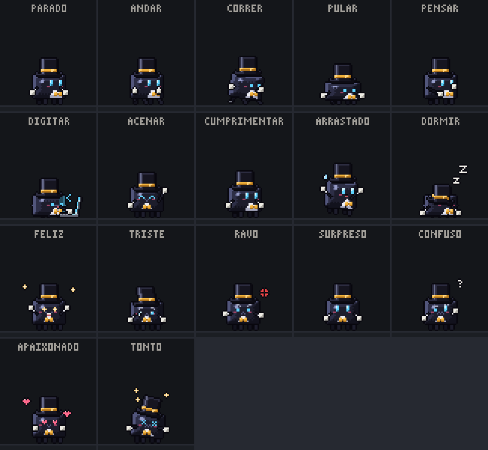

# Jarvis Code de cartola

Mascote em pixel art inspirado no Jarvis Code: corpo **preto** com reflexo, **cartola** de seda com faixa e fivela âmbar, casaca de mordomo (peito branco, gravata-borboleta e caudas que balançam), luvas brancas com punho, olhos ciano brilhantes e bochechas rosadas. Quadros de 48x48, olhando para a direita (o site já espelha para a esquerda).

## Animações

| Arquivo | O que faz | Quadros | fps | Repete |
|---|---|---|---|---|
| `idle_NN.png` | parado (respira e pisca) | 8 | 6 | sim |
| `walk_NN.png` | andar | 8 | 10 | sim |
| `run_NN.png` | correr (com poeira) | 8 | 14 | sim |
| `jump_NN.png` | pular (a cartola flutua na descida) | 8 | 14 | não |
| `think_NN.png` | pensar (mão no queixo, reticências) | 8 | 6 | sim |
| `notebook_NN.png` | digitar no notebook (com pausa, Enter e símbolos de código) | 48 | 12 | sim |
| `wave_NN.png` | acenar (de frente) | 8 | 8 | sim |
| `tiphat_NN.png` | cumprimentar (ergue a cartola) | 12 | 8 | não |
| `drag_NN.png` | sendo arrastado (pendurado, esperneando) | 8 | 10 | sim |
| `sleep_NN.png` | dormir (cartola nos olhos, zzz) | 8 | 4 | sim |

- `sprites/`: um PNG por quadro (transparente). Os nomes `walk`, `jump`, `think` e `notebook` são os mesmos que o Jarvis Desktop e o site (`/jc/`) já usam: copiar para `mascote/sprites` troca o mascote. As outras animações precisam ser ligadas no código.
- `folhas/`: cada animação numa tira horizontal (para motores de jogo).
- `previa/`: GIFs ampliados de cada animação.
- `animacoes.json`: quadros, fps e se repete, no formato do `ANIMS` do `site-jc.js`.

## Gerar de novo

Tudo é desenhado por código, sem dependências: edite `gerar.mjs` (paleta, cartola, poses) e rode `node mascote-cartola/gerar.mjs`.
